# 店舗スタッフ操作マニュアル（A550）

- **版**: 2026-11-02（Asia/Tokyo）／**一般公開版**
- **対象**: 店舗スタッフ全員
- **前提**: 2026-11-02 実運用・一般公開開始（`docs/STORE_OPS_GA_RELEASE_REPORT.md`）。App97 everyone 利用可（削除不可）。App92 バーコード引き取りは全ログインユーザー可（v1.3.0）
- **画面**: `docs/artifacts/store_ops_manual/`

対象アプリ:

| App | 名称 | 用途 |
|-----|------|------|
| 96 | 個人顧客マスタ | 顧客検索・新規 |
| 16 | 受注明細管理 | 着物受注・店舗受注表印刷 |
| 97 | 店舗入金管理 | 入金・会計照合・（代替）引き取り |
| 19 | 納品書作成 | 納品書作成・印刷 |
| 92 | 店舗納期カレンダー | 納期／引き取り待ち在庫／バーコード引き取り |
| 30 | 仕上げ完了登録 | 工場側完了（店舗は参照程度） |

---

## 1. 個人顧客の検索・新規登録（App96）

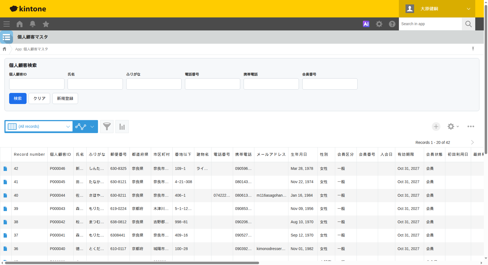

### 検索
1. App96「個人顧客マスタ」を開く
2. 上部「個人顧客検索」で **個人顧客ID／氏名／ふりがな／電話／携帯／会員番号** を入力
3. **検索** → 一覧から対象を開く
4. **個人顧客ID**（例: `P000046`）を控える（受注・入金のキー）

### 新規登録
1. **新規登録**（または kintone「+」）
2. 必須項目（氏名・ふりがな・連絡先など）を入力して保存  
   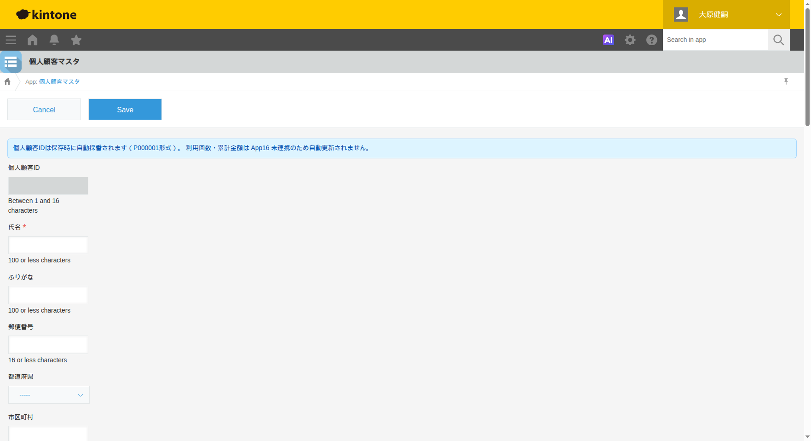
3. 採番された **個人顧客ID** を確認する

**注意**: 氏名だけでは一意にならない。以降の操作は必ず個人顧客IDで紐付ける。

---

## 2. 着物の受注登録（App16）

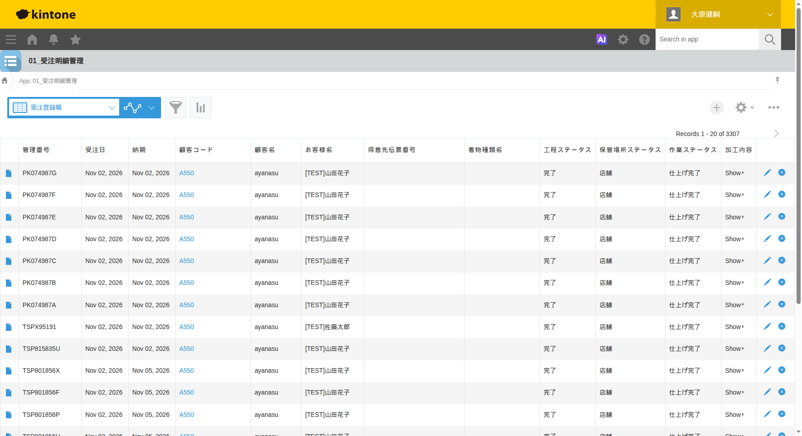

1. App16「01_受注明細管理」→ **+**（新規）  
   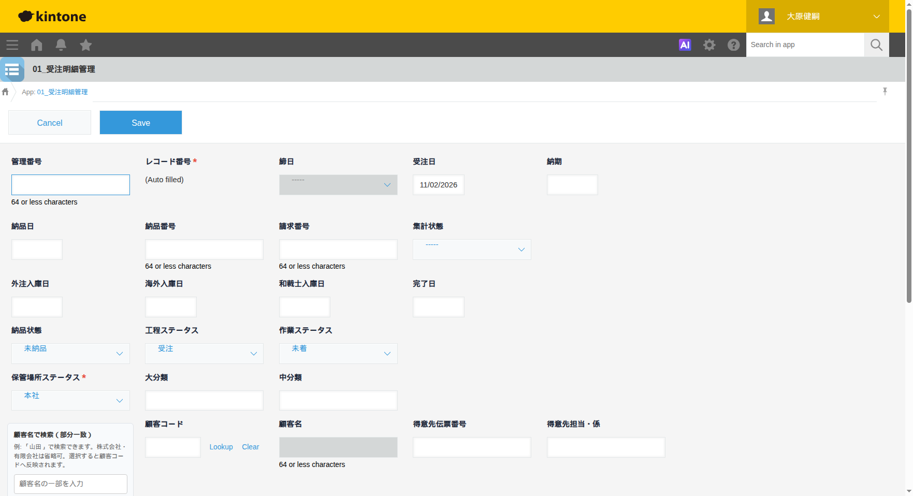
2. 得意先は **店舗（A550）** を選択（法人コードを選ばない）
3. **個人顧客ID** を入力／検索連携で紐付け（お客様氏名が連動）
4. 着物種類・明細（品名・数量・単価）を入力
5. 納期・受付情報を確認して保存
6. **管理番号**（例: `TSP…`）が採番されることを確認  
   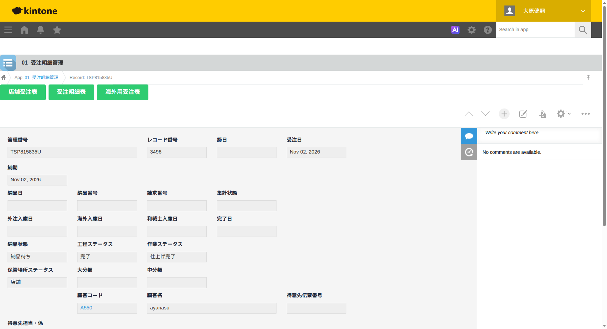

**触らない**: 法人受注の工程・納品フィールドを店舗フローで書き換えない。

---

## 3. 店舗受注表の印刷（App16）

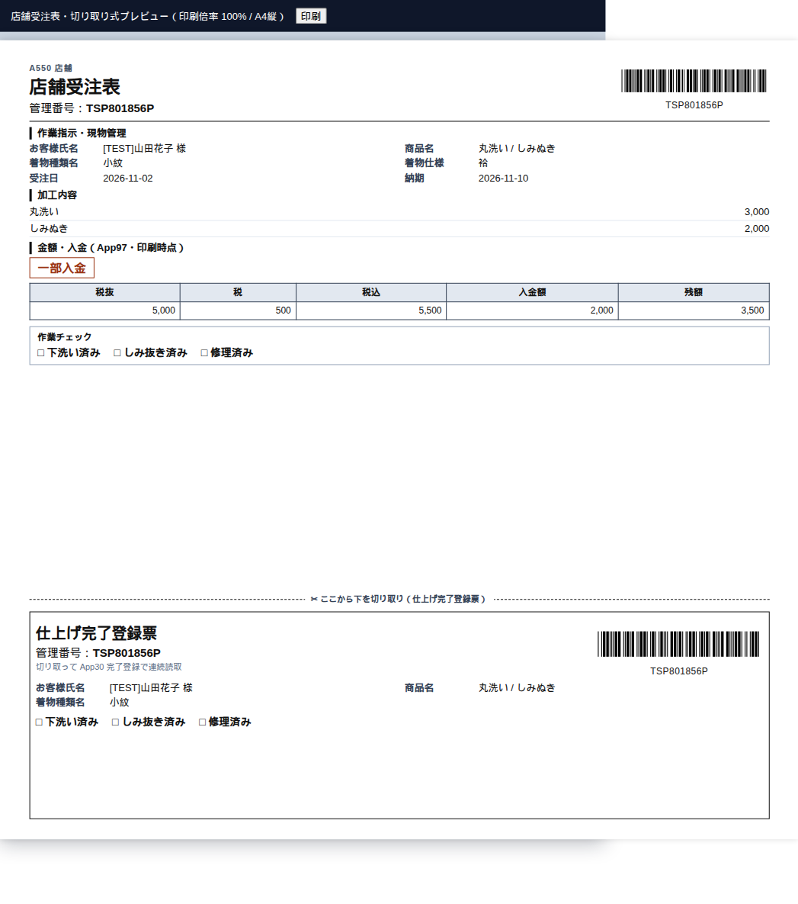

1. A550 受注の詳細画面を開く
2. 印刷メニューから **店舗受注表** を選択（法人には出ない）
3. プレビュー確認:
   - 上部: 店舗受注表（お客様控え側）
   - 下部: 仕上げ完了登録票（作業側）
   - 中央: 切り取り線
   - 上下とも **管理番号バーコード**
   - 入金: **入金済／未入金** の二値
4. 印刷 → 切り取り線で切ってお客様に上部を渡す

現プラグイン: **v149**（左右バーコードのみレイアウト完成）。詳細: `docs/A550_STORE_ORDER_V148.md` ほか。

---

## 4. 受注時の入金登録（App97）

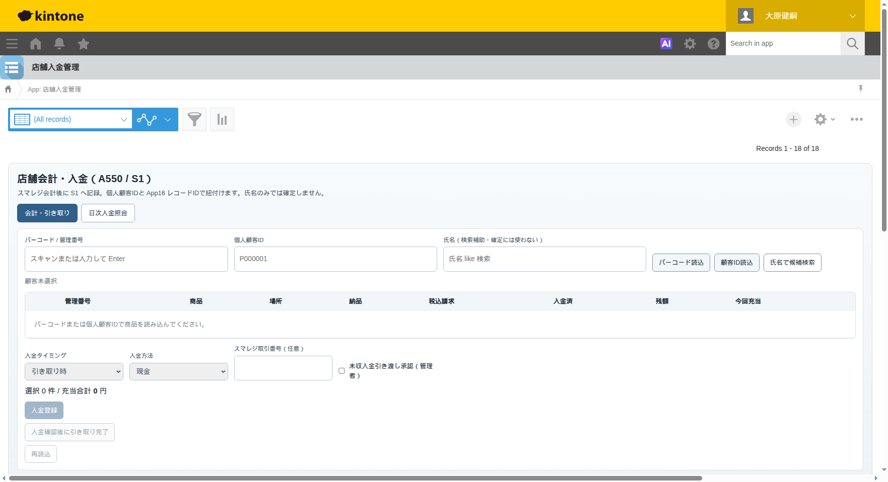

**権限**: 店舗スタッフ（everyone）。入金レコードの物理削除は不可。

1. スマレジで税込会計し、**取引番号と税込金額**を控える
2. App97「店舗入金管理」を開く（タブ「会計・引き取り」）
3. **バーコード／管理番号** をスキャン → **バーコード読込**  
   または **個人顧客ID** → **顧客ID読込**
4. 一覧で商品・場所・納品状態・残額を確認し、今回充当する行を選ぶ
5. 入金タイミング（受注時／引き取り時）、入金方法（現金など）、任意でスマレジ取引番号を入力
6. **入金登録**
7. 残額 0 になった行のみ、後続の引き取り対象になる

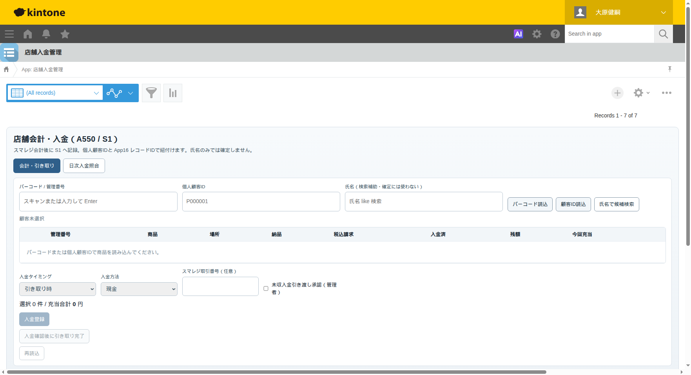

**禁止**: レコードの物理削除。誤りは **取消**（履歴残し）または返金レコード。

---

## 5. 納品書の作成・印刷（App19）

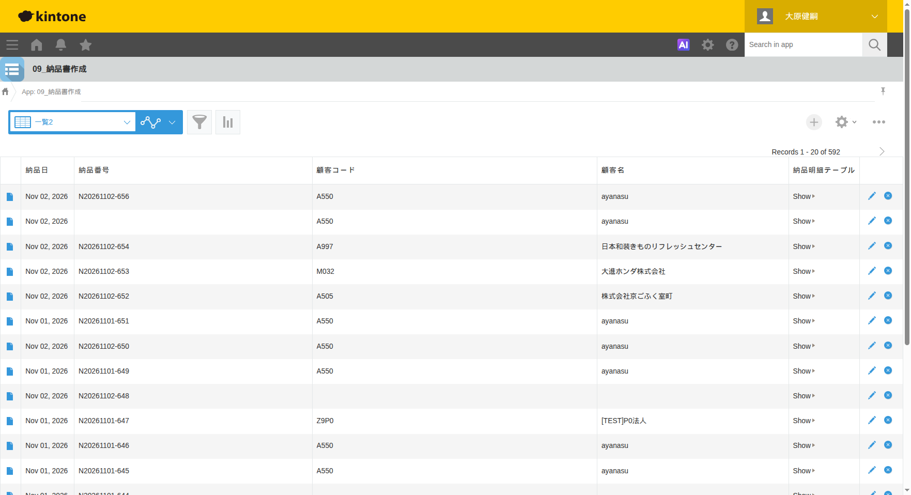

1. App19「09_納品書作成」→ 新規  
   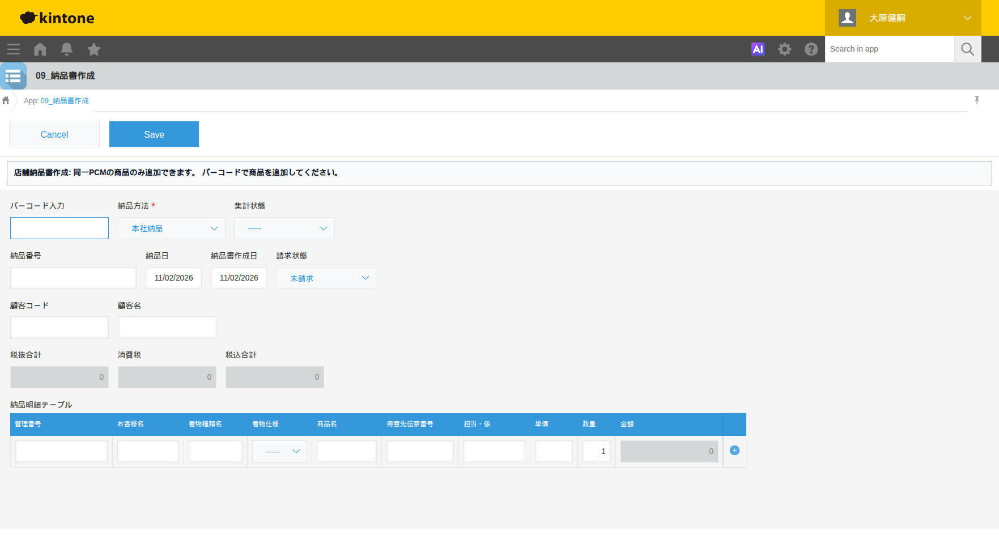
2. 得意先 **A550**、納品日、明細に **管理番号** を入れる
3. 保存 → `delivery_no` が付与され、App16 が自動同期される  
   - 店舗にあり完了済 → **引き取り待ち**  
   - 工場など未着 → **納品待ち**（店舗到着後に引き取り待ち）
4. 印刷プラグインで納品書を印刷  
   

**注意**:
- 納品書作成だけでは **納品済にしない**
- 反映済み納品書の明細削除・差し替えは原則禁止（管理者手順へ）
- `process_status` / `location_status` / `work_status` は変わらない

---

## 6. 引き取り待ち在庫の確認（App92）

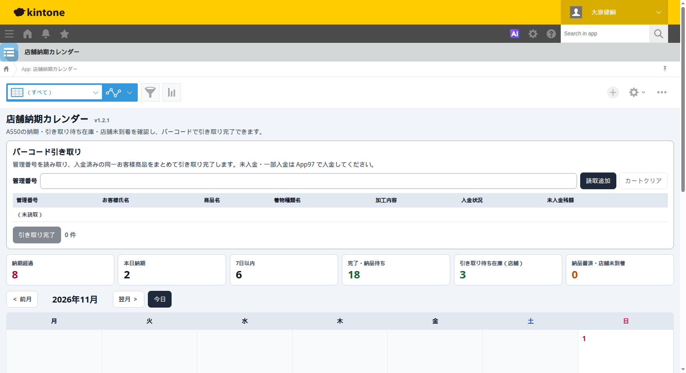

1. App92「店舗納期カレンダー」を開く
2. KPI **「引き取り待ち在庫（店舗）」** を確認（完了 ∧ 店舗 ∧ 引き取り待ち／互換の納品待ち ∧ 納品書番号あり）
3. 必要なら一覧・検索で管理番号を特定
4. **店舗未到着** KPI は工場側。店舗に届くまでバーコード引き取りしない

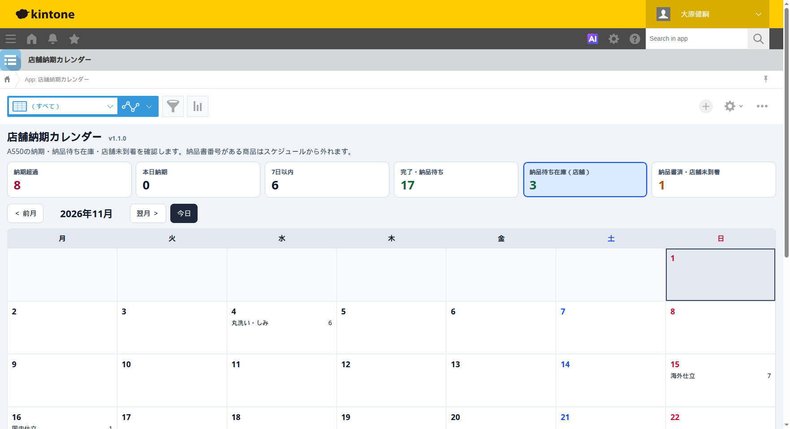

スケジュール上、納品書番号がある受注は納期カレンダーから除外される（仕様）。

---

## 7. バーコードによる引き取り完了（App92）

**権限**: ログイン済み店舗スタッフ（App92 v1.3.0 以降）。

1. App92 上部「バーコード引き取り」で **管理番号** をスキャン → **読取追加**
2. 表で氏名・商品・入金状況・未入金残額を確認
3. **同一個人顧客ID** の商品だけカートに載せる（別お客様は拒否）
4. 残額 0 の行だけを対象に **引き取り完了**
5. App16 の `delivery_status` のみ **納品済** になる（工程・場所・作業は不変）
6. KPI「引き取り待ち在庫」から消えることを確認

代替: App97 の「入金確認後に引き取り完了」でも同じ共有処理を使う。

---

## 8. 未入金・一部入金の場合の処理

| 状況 | スタッフの操作 |
|------|----------------|
| 未入金／一部入金 | App92 では引き取り完了できない。案内どおり **App97 で入金** |
| 当日会計して渡す | スマレジ → App97 入金登録（残額0）→ App92 または App97 で引き取り完了 |
| 先払い済み | App92 でバーコード → そのまま引き取り完了 |
| 例外の未収引き渡し | **管理者のみ** App97「未収入金引き渡し承認」チェック。通常運用では使わない |

一部入金のまま引き取ることはシステムが拒否する（限定 E2E 確認済）。

---

## 9. 誤操作・訂正時の対応

| 誤り | スタッフ | 管理者 |
|------|----------|--------|
| 入金金額ミス | 処理停止を報告 | App97 で取消／返金レコード。物理削除しない |
| 二重入金っぽい | 再読込して残額確認 | `transaction_id`／取消理由を確認 |
| 入金成功・引き取り失敗 | 入金は残す | 正しい管理番号で「引き取り完了」再実行 |
| 納品書の明細削除・差し替え | **しない** | `docs/A550_DELIVERY_CORRECTION_RUNBOOK.md` に従い App16 の `delivery_no` 等を手修正 |
| 誤って納品済 | 報告のみ | App16 手修正は別承認。在庫・入金影響を確認 |
| 法人レコードを触った | 直ちに報告 | 法人経路は変更禁止。差分を戻す |

記録に残す項目: 日時、管理番号、個人顧客ID、納品書番号、入金番号、操作者、前後の `delivery_status`。

---

## クイックフロー

```text
App96 顧客 → App16 受注 → 店舗受注表印刷
  →（任意）App97 受注時入金
  → 作業・完了（App30 等）
  → App19 納品書（→ 引き取り待ち／納品待ち）
  →（工場なら）店舗到着で引き取り待ち
  → App92 在庫確認 → 残額0ならバーコード引き取り
  → 未入金なら App97 → 引き取り完了
```
